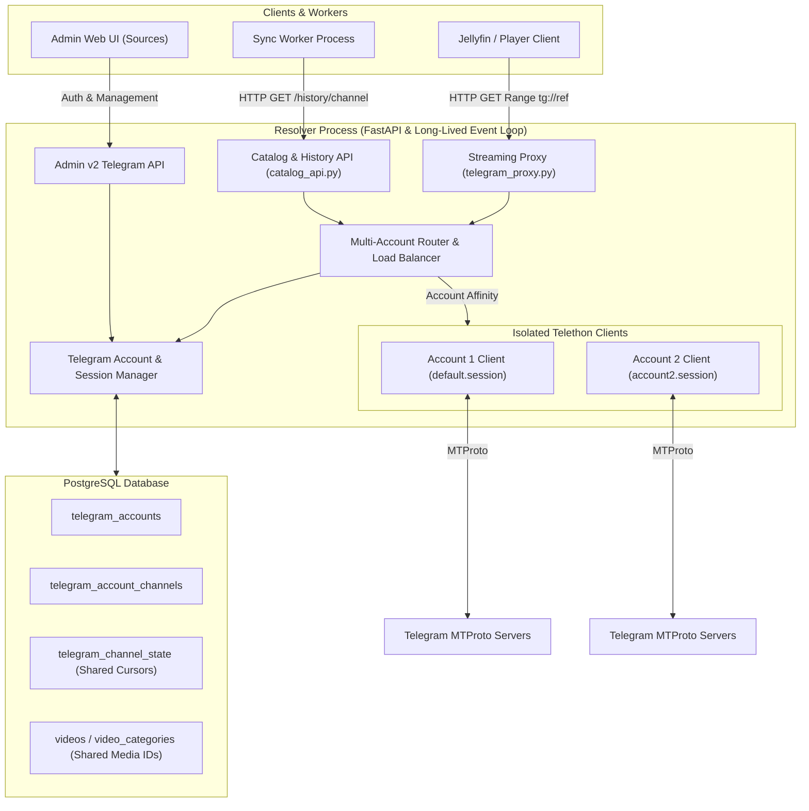

# Multi-Account Telegram Architecture

## 1. Executive Summary & Current-State Audit

Adult Hub provides automated indexing, metadata generation, and streaming proxy capabilities for Telegram channels via MTProto (Telethon). In the initial baseline architecture:

- **Session Storage**: A single SQLite session file defaults to `/data/telegram.session` (or `/cache/telegram_v2.session` via `TELEGRAM_SESSION_PATH`).
- **Client Lifecycle**: `resolver/providers/telegram.py` manages a module-level singleton `TelegramClient` (`_client`), connected on demand within the Resolver's asyncio event loop.
- **Login Manager**: `resolver/providers/telegram_login.py` implements a transient, bounded challenge workflow for SMS/2FA logins, internally using `TelegramAccountContext` (`DEFAULT_ACCOUNT_ID = "default"`), but `resolver/admin_v2_telegram_auth.py` strictly restricts endpoint requests to `DEFAULT_ACCOUNT_ID`.
- **Sync Architecture**: The `sync` worker process does **not** connect directly to Telethon or open the SQLite session; instead, it consumes Resolver internal HTTP endpoints (e.g. `GET /admin/api/telegram/history/{channel_id}`) to paginate channel messages and ingest video records.
- **Identified Gaps**:
  1. No persistent database registry for multiple accounts (`telegram_accounts` and `telegram_account_channels`).
  2. Single-account bottleneck for streaming and history extraction.
  3. Lack of channel-to-account access mapping: private channels accessible to Account B but not Account A could not be utilized.
  4. Inability to balance streaming load across multiple authenticated accounts or route around per-account FloodWait limits without evasion.

---

## 2. Process Boundaries & Session Ownership

### Why Resolver Owns All Telethon Sessions
1. **SQLite Concurrency Hazards**: Telethon's SQLite session backend (`SQLiteSession`) stores auth keys, DC tables, and entity access hashes. Concurrent access across multiple OS processes (e.g., Sync + Resolver) triggers `sqlite3.OperationalError: database is locked` or data corruption.
2. **Asyncio Event Loop Pinning**: Telethon's connection and transport internals bind to the active asyncio event loop at connect time. As documented in official Telethon guidance, connected clients cannot change event loops without throwing runtime errors (`The asyncio event loop must not change after connection`).
3. **Architectural Choice**: The Resolver process is the sole custodian of MTProto network connections, SQLite session files, and active `TelegramClient` instances. The Sync worker continues to communicate with the Resolver exclusively over authenticated HTTP, ensuring 100% process isolation and zero SQLite lock contention.

---

## 3. System Architecture & Request Flows



---

## 4. Multi-Account Storage & Migration Model

### PostgreSQL Schema
The database models accounts and per-account channel access status without storing credentials or passwords:

```sql
CREATE TABLE IF NOT EXISTS public.telegram_accounts (
    account_id text PRIMARY KEY,
    label text NOT NULL DEFAULT '',
    phone_mask text NOT NULL DEFAULT '',
    enabled boolean NOT NULL DEFAULT true,
    session_file text NOT NULL,
    created_at timestamp with time zone DEFAULT CURRENT_TIMESTAMP NOT NULL,
    updated_at timestamp with time zone DEFAULT CURRENT_TIMESTAMP NOT NULL
);

CREATE TABLE IF NOT EXISTS public.telegram_account_channels (
    account_id text NOT NULL REFERENCES public.telegram_accounts(account_id) ON DELETE CASCADE,
    channel_id text NOT NULL,
    access_status text NOT NULL DEFAULT 'unknown', -- 'accessible', 'no_access', 'temporary_error', 'flood_wait', 'unknown'
    last_checked_at timestamp with time zone,
    error_detail text NOT NULL DEFAULT '',
    PRIMARY KEY (account_id, channel_id)
);
```

### Legacy Migration & Backward Compatibility
- **Migration Numbering**: Migration `m0066_telegram_accounts.py` (legacy v66, current chain v18) creates tables idempotently.
- **Zero-Downtime Legacy Discovery**: On startup, if `telegram_accounts` is empty but a legacy session file exists at `TELEGRAM_SESSION_PATH`, the system auto-registers the `default` account, preserving existing authorization without requiring re-login.
- **Deletion Safety**: Deleting an account removes its entry from `telegram_accounts`, cascades deletion in `telegram_account_channels`, and purges its `.session` file from disk. **It never deletes channels, media files, .strm pointers, or Jellyfin catalog items.**

---

## 5. Channel Access Mapping & Router Design

### Account Isolation & Private Entities
Each Telegram user account has its own private channel subscriptions, access hashes, and member permissions:
- Account 1 may have joined private Channel X, but not private Channel Y.
- Telethon stores entity access hashes per session file. Telethon entity cache is never shared across session files.
- The **Account Router** queries `telegram_account_channels` and runtime health state to filter candidates for any channel operation.

### Routing Strategy: Least-Loaded Eligible Selection
When an operation needs a client for `channel_id`:
1. **Filter**:
   - `enabled == true`
   - `authorized == true`
   - Not in `FloodWait` cooldown (`now >= cooldown_until`)
   - Channel not marked `no_access` (or access unverified but not explicitly failed)
2. **Prioritize**:
   - Accounts with verified `accessible` status for `channel_id`.
3. **Select**:
   - Select candidate with minimum active concurrent operations (`least_loaded`).
4. **Affinity**:
   - For a streaming request, once an account is selected and begins streaming bytes, **account affinity is strictly maintained** for that request. If a mid-stream network drop occurs after HTTP 206 headers are sent, the connection aborts truthfully to allow player seek/reconnect; response restarts or cross-account switches are prohibited.

### FloodWait vs Temporary vs Access Errors
- **FloodWait (`FloodWaitError`)**: Telethon extracts `e.seconds`. The router records a cooldown (`cooldown_until = now + e.seconds`) on that specific account. **Never attempt to bypass FloodWait on another account.**
- **Channel Access Errors (`ChannelPrivateError`, `ChatAdminRequiredError`, `UserNotParticipantError`)**: The router marks `telegram_account_channels.access_status = 'no_access'` for that account. Other accounts that belong to the channel remain eligible.
- **Transient Network Errors (`ConnectionError`, `asyncio.TimeoutError`)**: Standard exponential backoff retry on the assigned client.

---

## 6. Shared Synchronization & Cursor Safety

1. **Single Pipeline & Shared Cursor**:
   - The sync worker maintains exactly **one** pipeline and **one** cursor in `telegram_channel_state` per channel.
   - Channel media IDs are invariant: `telegram:{channel_id}:{message_id}:{file_unique_id}`.
2. **No Deletion on Access Loss**:
   - If all accounts lose access to a channel, the sync worker marks the batch as a resumable warning and skips the channel.
   - The channel cursor (`latest_cursor`, `backfill_cursor`) and `latest_watermark` remain untouched.
   - Existing catalog entries and `.strm` files are never purged due to temporary access loss.
3. **Resumption**:
   - Once an authorized account with channel access is restored, the next sync run resumes exactly from the preserved cursor.

---

## 7. Streaming Workload & Parallelism Policy (Milestone D)

### HTTP Range Integrity & Account Affinity
- **Range Truthfulness**: Standard HTTP 206 Partial Content delivery with exact `Content-Range: bytes START-END/TOTAL` and `Content-Length`. Empty ranges or invalid bounds produce truthful 416 Range Not Satisfiable headers.
- **Account Affinity**: For any in-flight streaming request, the assigned account client is pinned for the lifetime of the stream (`job_key=_account_id`). If an account encounters a network drop or cooldown mid-stream after HTTP headers have been transmitted, the connection aborts truthfully to allow player seek/reconnect; mid-stream account switching is strictly prohibited to prevent chunk boundary corruption and session thrashing.
- **Cross-Account Chunk Downloading Policy**:
  - **Decision**: Deferred / disabled by default. Cross-account striped downloading across multiple Telethon sessions introduces severe MTProto session switching overhead, file reference desynchronization, and DC hop latency with no verified throughput benefit.
  - **Shared Canonical RAM Cache**: Streams downloading the same document share verified canonical blocks (`key=tg:{channel}:{msg}:{doc_id}:{total}`) in RAM. In-flight jobs are isolated per account (`job_key=_account_id`) to preserve session stability and authorization boundaries without cross-account failure propagation. Because in-flight blocks remain account-scoped, if multiple accounts concurrently request the same uncached block, each account performs its own upstream fetch (no cross-account in-flight dedup). However, once a verified block completes, it is stored in the shared canonical RAM cache, where subsequent reads across all accounts reuse the completed block directly from cache without upstream fetches.

### Bounded Concurrency, Priority & Backpressure
1. **Bounded Concurrency**:
   - `workers`: Max concurrent fetch workers per stream (default: 3, configured via `TELEGRAM_DOWNLOAD_WORKERS`).
   - `global_workers`: Max concurrent fetch workers across all streams (default: 6, configured via `TELEGRAM_DOWNLOAD_GLOBAL_WORKERS`).
   - `account_workers`: Optional cap on concurrent fetch workers per Telegram account (configured via `TELEGRAM_DOWNLOAD_ACCOUNT_WORKERS`).
   - `max_leases_per_account`: Router concurrency limit for simultaneous operations per account (default: 20, configured via `TELEGRAM_MAX_CONCURRENT_LEASES_PER_ACCOUNT`; must be a positive integer, non-positive values fall back safely to 20 with a logged warning).
2. **Playback Priority**:
   - Priority 0 (**Demand**): Blocks currently needed for active playback.
   - Priority 1 (**Prefetch**): Blocks pre-fetched ahead within read-ahead window.
   - Candidate scheduling strictly prioritizes Demand blocks over Prefetch blocks, followed by least-loaded accounts for fairness across accounts and streams.
3. **Backpressure & Cancellation**:
   - When in-flight and cached blocks reach `max_cache_bytes` (default: 128MB), worker fetching pauses on an asyncio condition variable until downstream consumer yields and unpins blocks.
   - Client disconnects or playback cancellations immediately cancel in-flight upstream fetch tasks and reclaim reserved memory.

---

## 8. In-Memory Operational Metrics & Admin UI Status (Milestone E)

### Bounded In-Memory Operational Metrics
To avoid PostgreSQL write amplification and database lock contention on high-frequency streaming events, operational metrics are tracked strictly in memory inside `TelegramAccountRouter`:

| Metric | Type | Scope | Description |
| :--- | :--- | :--- | :--- |
| `active_ops` | Integer gauge | Per account | Current active streaming and sync leases. |
| `bytes_transferred` | Integer counter | Per account | Total bytes delivered through this account. |
| `errors_count` | Integer counter | Per account | Total network, access, and protocol errors handled. |
| `flood_wait_count` | Integer counter | Per account | Total FloodWait events encountered. |
| `cooldown_seconds` | Integer gauge | Per account | Remaining cooldown seconds (0 when healthy). |
| `throughput_mb_s` | Float gauge | Per account | Sliding 60-second window throughput (compacted to <= 100 entries). |
| `buffer_init_latency_ms` | Float gauge | Per account | Arithmetic mean of the last 20 TTFB / initial buffer latency samples in ms. |
| `last_error` | Object (redacted)| Per account | Redacted error type and sanitized summary (tokens, paths, and phones stripped). |

### Channel Access Tracking & Secrecy
- **Channel Access Mapping**: `telegram_account_channels` maintains access status (`accessible`, `inaccessible`, `no_access`, `flood_wait`, `temporary_error`, `unknown`) per account.
- **Admin UI Cards**: The Sources Admin UI displays per-account cards showing connected status, phone mask, verified channels count, inaccessible channels count, active streams, transferred bytes, throughput, TTFB latency, and cooldown timers.
- **Public Secrecy Protection**:
  - Admin endpoints (`/api/v2/telegram/*`) enforce local/admin authentication (`_admin_blocked`) returning HTTP 403 to unauthenticated or external traffic.
  - Public `/health`, `/metrics`, and streaming proxy responses never disclose internal account IDs, session file paths, phone numbers, or private channel credentials.

---

## 9. Upgrade, Rollback & Data Preservation Procedures

### Single-Account Backward Compatibility
- Baseline single-account setups continue to function without modification.
- On first startup with multi-account code, if `telegram_accounts` is empty, `TelegramAccountStore` automatically registers the existing session file at `TELEGRAM_SESSION_PATH` as the `default` account. No re-login is required.

### Database Migration Safety
- Table migration `m0066_telegram_accounts.py` (legacy v66, chain v18) creates `telegram_accounts` and `telegram_account_channels` idempotently.
- No high-frequency operational metrics or streaming counters are written to PostgreSQL.
- **Media IDs & Cursor Preservation**:
  - Cursors in `telegram_channel_state` (`latest_cursor`, `backfill_cursor`, `latest_watermark`) are invariant and shared.
  - Video IDs (`telegram:{channel_id}:{message_id}:{file_unique_id}`) and catalog entries are never altered, removed, or duplicated when accounts are added or removed.

### Safe Rollback Instructions
If rolling back to a single-account release:
1. Ensure the primary account's `.session` file is present at `TELEGRAM_SESSION_PATH` (defaults to `/data/telegram.session`).
2. Stop the application services (`docker compose down`).
3. Deploy the previous container image.
4. The legacy release reads `TELEGRAM_SESSION_PATH` directly; the tables `telegram_accounts` and `telegram_account_channels` remain benignly in PostgreSQL schema without interfering with single-account operations. Catalog entries, `.strm` files, and sync cursors remain 100% intact.

---

## 10. Benchmarking Methodology, Results & Limitations

### Reproducible Benchmark Harness
Run the deterministic synthetic benchmark suite using the provided CLI tool:

```bash
# Run both Scenario 1 (Independent Concurrent Streams) and Scenario 2 (Same-Video Shared Cache)
.venv/bin/python3 scripts/benchmark_telegram_multi_account.py --accounts 3 --streams 12 --chunks 5

# Test FloodWait cooldown handling and lease exclusion
.venv/bin/python3 scripts/benchmark_telegram_multi_account.py --simulate-floodwait

# Run specific scenarios
.venv/bin/python3 scripts/benchmark_telegram_multi_account.py --scenario independent
.venv/bin/python3 scripts/benchmark_telegram_multi_account.py --scenario shared
```

### Redacted Sample Benchmark Output

```json
{
  "admin_auth_status": "Blocked: No authenticated Admin browser or session is available in this computer environment.",
  "real_account_comparisons_run": false,
  "live_performance_note": "Synthetic benchmark timings only; live MTProto network performance unverified. No real Telegram network requests were made.",
  "independent_streams_scenario": {
    "num_accounts": 3,
    "num_streams": 12,
    "chunks_per_stream": 5,
    "simulate_floodwait": false,
    "synthetic_elapsed_seconds": 0.086,
    "cpu_process_seconds": 0.0144,
    "memory_peak_rss_mb": 128.74,
    "synthetic_transferred_mb": 60.0,
    "synthetic_throughput_mb_s": 695.52,
    "synthetic_avg_ttff_ms": 18.73,
    "synthetic_min_ttff_ms": 16.61,
    "synthetic_max_ttff_ms": 20.9,
    "synthetic_avg_initial_buffer_ms": 18.73,
    "synthetic_avg_stream_latency_seconds": 0.082,
    "synthetic_affinity_violations_count": 0,
    "synthetic_errors_count": 0,
    "synthetic_per_account_chunks": {
      "sim_acc_1": 20,
      "sim_acc_2": 20,
      "sim_acc_3": 20
    },
    "synthetic_distribution_fairness_verified": true,
    "synthetic_floodwait_cooldown_honored": true,
    "synthetic_cooling_leases_during_cooldown_count": 0,
    "synthetic_cooling_accounts_received_no_leases": true
  },
  "same_video_shared_cache_scenario": {
    "num_readers": 4,
    "blocks_per_reader": 10,
    "block_size_bytes": 524288,
    "total_file_size_bytes": 5242880,
    "synthetic_elapsed_seconds": 0.071,
    "cpu_process_seconds": 0.0055,
    "upstream_fetch_calls": 20,
    "upstream_bytes_fetched": 10485760,
    "total_delivered_bytes": 20971520,
    "total_delivered_mb": 20.0,
    "delivered_to_upstream_bytes_ratio": 2.0,
    "synthetic_throughput_mb_s": 281.85,
    "first_reader_upstream_ttff_ms": 16.02,
    "subsequent_reader_cache_ttff_avg_ms": 20.03,
    "cache_peak_bytes": 2621440,
    "cache_current_bytes": 2621440,
    "cache_max_bytes": 2621440,
    "cache_bounded": true
  }
}
```

### Tested vs. Unverified Status
1. **Verified in Automated Suites**:
   - Strict stream account affinity (0 cross-account violations under concurrency).
   - Least-loaded lease balancing and fairness across available accounts.
   - Immediate FloodWait cooldown isolation and affinity refusal during wait periods.
   - Demand playback block prioritization over prefetch blocks.
   - Shared canonical completed-block cache reuse (measuring delivered bytes vs upstream fetched bytes ratio; in-flight requests remain account-isolated).
   - Upstream fetch backpressure when RAM cache budget is saturated.
   - Client disconnection cancellation propagating to in-flight fetch tasks.
   - Bounded in-memory operational metrics and Admin UI status reporting.
2. **Explicitly Unverified in This Session**:
   - **Real Telegram Account Network Measurements**: The current computer session has no authenticated Admin browser session. Live MTProto streaming performance, real multi-account saturation, and physical SIM-backed flood thresholds were not measured against live Telegram servers. All metrics reported above are synthetic execution benchmarks measured against mocked MTProto network delays.
