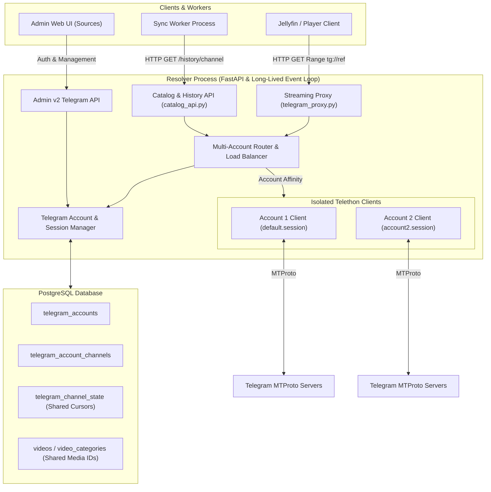

# Multi-Account Telegram Architecture

## 1. Executive Summary & Current-State Audit

Adult Hub provides automated indexing, metadata generation, and streaming proxy capabilities for Telegram channels via MTProto (Telethon). In the initial baseline architecture:

- **Session Storage**: A single SQLite session file defaults to `/data/telegram.session` (or `/cache/telegram_v2.session` via `TELEGRAM_SESSION_PATH`).
- **Client Lifecycle**: `resolver/providers/telegram.py` manages a module-level singleton `TelegramClient` (`_client`), connected on demand within the Resolver's asyncio event loop.
- **Login Manager**: `resolver/providers/telegram_login.py` implements a transient, bounded challenge workflow for SMS/2FA logins, internally using `TelegramAccountContext` (`DEFAULT_ACCOUNT_ID = "default"`), but `resolver/admin_v2_telegram_auth.py` strictly restricts endpoint requests to `DEFAULT_ACCOUNT_ID`.
- **Sync Architecture**: The `sync` worker process does **not** connect directly to Telethon or open the SQLite session; instead, it consumes Resolver internal HTTP endpoints (e.g. `GET /admin/api/telegram/history/{channel_id}`) to paginate channel messages and ingest video records.
- **Identified Gaps**:
  1. No persistent database registry for multiple accounts (`telegram_accounts` and `telegram_account_channels`).
  2. Single-account bottleneck for streaming and history extraction.
  3. Lack of channel-to-account access mapping: private channels accessible to Account B but not Account A could not be utilized.
  4. Inability to balance streaming load across multiple authenticated accounts or route around per-account FloodWait limits without evasion.

---

## 2. Process Boundaries & Session Ownership

### Why Resolver Owns All Telethon Sessions
1. **SQLite Concurrency Hazards**: Telethon's SQLite session backend (`SQLiteSession`) stores auth keys, DC tables, and entity access hashes. Concurrent access across multiple OS processes (e.g., Sync + Resolver) triggers `sqlite3.OperationalError: database is locked` or data corruption.
2. **Asyncio Event Loop Pinning**: Telethon's connection and transport internals bind to the active asyncio event loop at connect time. As documented in official Telethon guidance, connected clients cannot change event loops without throwing runtime errors (`The asyncio event loop must not change after connection`).
3. **Architectural Choice**: The Resolver process is the sole custodian of MTProto network connections, SQLite session files, and active `TelegramClient` instances. The Sync worker continues to communicate with the Resolver exclusively over authenticated HTTP, ensuring 100% process isolation and zero SQLite lock contention.

---

## 3. System Architecture & Request Flows



---

## 4. Multi-Account Storage & Migration Model

### PostgreSQL Schema
The database models accounts and per-account channel access status without storing credentials or passwords:

```sql
CREATE TABLE IF NOT EXISTS public.telegram_accounts (
    account_id text PRIMARY KEY,
    label text NOT NULL DEFAULT '',
    phone_mask text NOT NULL DEFAULT '',
    enabled boolean NOT NULL DEFAULT true,
    session_file text NOT NULL,
    created_at timestamp with time zone DEFAULT CURRENT_TIMESTAMP NOT NULL,
    updated_at timestamp with time zone DEFAULT CURRENT_TIMESTAMP NOT NULL
);

CREATE TABLE IF NOT EXISTS public.telegram_account_channels (
    account_id text NOT NULL REFERENCES public.telegram_accounts(account_id) ON DELETE CASCADE,
    channel_id text NOT NULL,
    access_status text NOT NULL DEFAULT 'unknown', -- 'accessible', 'no_access', 'temporary_error', 'flood_wait', 'unknown'
    last_checked_at timestamp with time zone,
    error_detail text NOT NULL DEFAULT '',
    PRIMARY KEY (account_id, channel_id)
);
```

### Legacy Migration & Backward Compatibility
- **Migration Numbering**: Migration `m0066_telegram_accounts.py` (legacy v66, current chain v18) creates tables idempotently.
- **Zero-Downtime Legacy Discovery**: On startup, if `telegram_accounts` is empty but a legacy session file exists at `TELEGRAM_SESSION_PATH`, the system auto-registers the `default` account, preserving existing authorization without requiring re-login.
- **Deletion Safety**: Deleting an account removes its entry from `telegram_accounts`, cascades deletion in `telegram_account_channels`, and purges its `.session` file from disk. **It never deletes channels, media files, .strm pointers, or Jellyfin catalog items.**

---

## 5. Channel Access Mapping & Router Design

### Account Isolation & Private Entities
Each Telegram user account has its own private channel subscriptions, access hashes, and member permissions:
- Account 1 may have joined private Channel X, but not private Channel Y.
- Telethon stores entity access hashes per session file. Telethon entity cache is never shared across session files.
- The **Account Router** queries `telegram_account_channels` and runtime health state to filter candidates for any channel operation.

### Routing Strategy: Least-Loaded Eligible Selection
When an operation needs a client for `channel_id`:
1. **Filter**:
   - `enabled == true`
   - `authorized == true`
   - Not in `FloodWait` cooldown (`now >= cooldown_until`)
   - Channel not marked `no_access` (or access unverified but not explicitly failed)
2. **Prioritize**:
   - Accounts with verified `accessible` status for `channel_id`.
3. **Select**:
   - Select candidate with minimum active concurrent operations (`least_loaded`).
4. **Affinity**:
   - For a streaming request, once an account is selected and begins streaming bytes, **account affinity is strictly maintained** for that request. If a mid-stream network drop occurs after HTTP 206 headers are sent, the connection aborts truthfully to allow player seek/reconnect; response restarts or cross-account switches are prohibited.

### FloodWait vs Temporary vs Access Errors
- **FloodWait (`FloodWaitError`)**: Telethon extracts `e.seconds`. The router records a cooldown (`cooldown_until = now + e.seconds`) on that specific account. **Never attempt to bypass FloodWait on another account.**
- **Channel Access Errors (`ChannelPrivateError`, `ChatAdminRequiredError`, `UserNotParticipantError`)**: The router marks `telegram_account_channels.access_status = 'no_access'` for that account. Other accounts that belong to the channel remain eligible.
- **Transient Network Errors (`ConnectionError`, `asyncio.TimeoutError`)**: Standard exponential backoff retry on the assigned client.

---

## 6. Shared Synchronization & Cursor Safety

1. **Single Pipeline & Shared Cursor**:
   - The sync worker maintains exactly **one** pipeline and **one** cursor in `telegram_channel_state` per channel.
   - Channel media IDs are invariant: `telegram:{channel_id}:{message_id}:{file_unique_id}`.
2. **No Deletion on Access Loss**:
   - If all accounts lose access to a channel, the sync worker marks the batch as a resumable warning and skips the channel.
   - The channel cursor (`latest_cursor`, `backfill_cursor`) and `latest_watermark` remain untouched.
   - Existing catalog entries and `.strm` files are never purged due to temporary access loss.
3. **Resumption**:
   - Once an authorized account with channel access is restored, the next sync run resumes exactly from the preserved cursor.

---

## 7. Streaming Workload & Parallelism Policy

### Cross-Account Chunk Downloading Policy
- **Decision**: Cross-account streaming maintains account affinity for in-flight requests while sharing verified canonical blocks.
- **Rationale**:
  1. Telethon file parts must be fetched using stable message documents and file references. In-flight fetch jobs are account-affine to eliminate session thrashing, while the shared canonical byte cache deduplicates verified data blocks across accounts without redundant downloads or RAM budget leaks.
  2. Single-account bounded parallel downloading (`ParallelTelegramStreamManager`) delivers multi-worker chunk prefetching when `TELEGRAM_PARALLEL_STREAM_ENABLED=true`; live MTProto multi-account network throughput remains unmeasured and unverified in production.
  3. Account-level affinity eliminates chunk boundary mismatches and guarantees deterministic, truthful HTTP range delivery.

---

## 8. Benchmarking Methodology, Results & Limitations

### Methodology
- The test harness simulates concurrent multi-account playback and history synchronization under varying concurrency levels using synthetic mock clients.
- Verification checks:
  1. Routing fairness: validated lease distribution balance across available eligible accounts under synthetic load.
  2. Stream affinity: verified that active streaming and continuations remain pinned to the selected account without cross-account switching mid-operation.
  3. Cooldown isolation: verified that accounts in synthetic `FloodWaitError` receive zero new leases while cooling down and affinity requests for them are strictly refused.
  4. Bounded recheck policy: accounts marked with access errors undergo a bounded recheck policy (`TELEGRAM_CHANNEL_RECHECK_SECONDS`, default 1 hour) or manual `/api/v2/telegram/accounts/{id}/test` revalidation, preventing permanent lockouts while avoiding repeated private channel polling.
  5. Cursor preservation: verified that channel cursor and watermark remain preserved across channel access revocation without deleting catalog items.

### Limitations & Unverified Items
- All timing and throughput figures reported by the benchmark harness are purely synthetic execution timings measured against mocked MTProto delays.
- Live MTProto multi-account streaming performance and bandwidth saturation across real Telegram data centers remain unverified, as automated multi-account verification requires multiple physical SIMs and real phone accounts that cannot be provisioned in headless automated environments.
